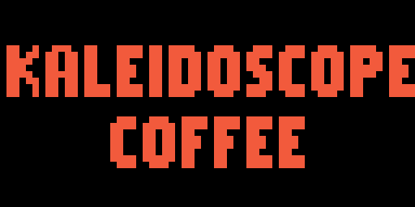
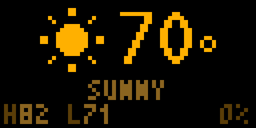
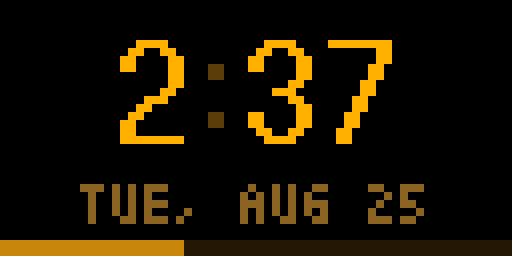

# tidbyt-apps

Custom apps for a Tidbyt (64×32 LED matrix) in a warm-dark espresso
palette, pushed standalone by GitHub Actions — no home machine involved.

| App | Preview | What it shows |
|---|---|---|
| **news** | — | Greenpoint headlines (Greenpointers + Brooklyn Paper RSS), vertical scroll, breaking-news state |
| **closing** |  | Kaleidoscope's goodbye: the retired logo card's flamingos wave, then "OUR LAST DAY / SUN NOV 15" with a live days-left countdown, then "THANK YOU GREENPOINT" with a beating heart. On the last day it reads "TODAY IS OUR LAST DAY"; from the day after, just the birds and the thank you. Pushed twice daily. |
| **weather** |  | Current temp, animated pixel-art conditions, daily high/low, precip chance (NWS + Open-Meteo blend, no API keys) |
| **clock** |  | Gold digits, blinking colon, date, seconds bar *(experimental — see note)* |

## Run them on your own Tidbyt

The official Tidbyt community catalog stopped accepting new apps after the
Modal acquisition, so this ships as a self-serve repo instead:

1. **Fork this repo** (keep it public — the free private-repo Actions quota
   won't cover the run frequency).
2. Add repo secrets (Settings → Secrets and variables → Actions):
   - `TIDBYT_DEVICE_ID` — Tidbyt app → device → settings → Get API key
   - `TIDBYT_API_TOKEN` — same screen
3. Enable the workflow(s) you want on the Actions tab (forks start with
   workflows disabled) and trigger each once via *Run workflow*.
4. For the weather app, edit the NWS gridpoint URLs at the top of
   `weather/weather.star` for your location: fetch
   `https://api.weather.gov/points/{lat},{lon}` and copy the `forecast`
   and `forecastHourly` URLs it returns. (US only — NWS.)

If you run a [Tronbyt](https://github.com/tronbyt) (self-hosted firmware)
instead, you don't need the push machinery — drop the `.star` files into
your server's apps folder.

## How the push model works

A Tidbyt shows whatever WebP it was last pushed. The weather app is a
short looping animation re-pushed every 10 minutes — a natural fit.

The news app is the awkward case: GitHub throttles free-tier cron to roughly
every 1–3 hours, so `push-news.yml` keeps a single run alive for ~5.5 hours
pushing every 10 minutes, with the next scheduled run queued behind it. That
is why it carries a `concurrency` block and a 355-minute timeout.

The clock is harder: it pre-renders future frames at 1 fps so the display
ticks between pushes, but **stock Tidbyt hardware only buffers a small
chunk of a long animation and loops it**, so the minute can stick. Treat
`clock` as experimental on stock devices; it works properly on Tronbyt,
where the server renders continuously. Pin any clock-style app so
rotation doesn't restart its animation.

## Deploying

```bash
./deploy.sh news|closing [pixlet render args]
```

A plain `git push` does not reach the panel for up to 5.5 hours: the
self-looping workflows pin both the run in progress and the queued run to
the commit they were created at, and the stale loop overwrites any manual
push every 10–15 minutes until it ends. `deploy.sh` renders and pushes
straight to the device, cancels the stale runs, and dispatches a fresh one
on HEAD. It refuses to run with uncommitted or unpushed changes.

## Local development

```bash
pixlet serve weather/weather.star   # live preview at localhost:8080
pixlet render weather/weather.star --gif --magnify 8 -o preview.gif
```

Pixlet quirk: keep each app in its own directory — two `.star` files in
one folder confuse the loader.

### Regenerating the closing card's frames

```bash
python3 closing/make_frames.py     # needs Pillow
```

The birds come from `closing/flamingos.py`, the generator of the retired
logo card (2026-10-06 to 2026-10-20; its scenes, opening-hours logic and push
script are in git history at 5b0a1eb). Body, head and wing are small ASCII
grids; the **neck is a cubic Bezier** from the front of the body to the head,
drawn with a 2x2 brush, so a pose is just a head position. The right bird is
the left one mirrored. The closing card bakes only the 48-frame "wave" scene
and the heart; its text pages are drawn live by `closing.star`.

Remove an app from a device with (disable its workflow first -- a scheduled
run will just push it straight back, which looks like the delete failing):

```bash
pixlet delete --api-token "$(cat ~/.config/tidbyt/token)" \
  "$(cat ~/.config/tidbyt/device_id)" <installation-id>
```

### Things the panel taught us

- The device this was designed against is mounted **portrait**, which is
  worth knowing before judging any layout.
- **1px lines do not read.** The matrix puts a black gutter between every
  diode, so a single-pixel leg becomes a column of separate dots and the bird
  looks like it is standing beside its legs. (The 2026-10-06 cartoon birds
  went back to 1px legs anyway, at Adam's call after seeing 2px on the
  panel -- the neck and steam stay 2px.) Judge pixel art by
  simulating those gutters, not by magnifying a render.
- Two shades of one hue barely separate at panel brightness — don't rely on
  it to carry a *shape*. It is fine for shading a shape you have already
  established: the birds' lower edges are a darker coral at about 2:1 against
  the body, which gives the mass some form without risking the silhouette.
  Anything load-bearing needs a real value gap.
- Black is invisible *against* black, but black *inside* a lit shape is the
  strongest mark available. That is how the eye is drawn: one unlit pixel in
  the head, the genre convention — a bright pupil there competed with the
  bill and read as a glint. A 1px unlit wing fold was tried on the
  hand-drawn body and read as three specks, not a line; the belly shadow does
  the wing's work instead.
- A true black bill tip is unreachable here: at the outer end of the bill it
  would border the background on three sides and vanish. The downward hook is
  carried by shape alone, in the bill's own pale colour.
- Sleeping birds show no bill and no eye: a roosting flamingo lays its head
  along its back with the bill tucked.
- Fidelity to the logo is not the goal; reading as a flamingo is. The
  downscaled logo kept every proportion and read as nothing. Draw the cues,
  not the artwork.
- A counter line that touches a leg reads as a shelf the bird is standing on.
  The cups' counter now stops well short of the legs.
- **Nothing may be black**, since the background is. A witch hat is purple.
  The one exception is unlit pixels *inside* a lit shape — the number strokes
  on the marathon bib work precisely because white surrounds them.
- Small shapes want one hue. Alternating colours inside a 3px-wide band
  dissolve it; save the colour play for something big enough to hold it.
- Check contrast against black. A gray below about 2:1 simply is not there on
  a lit floor.
- Check relative luminance against the *subject*, not just against black. The
  firmware applies CIE luminance correction, so sRGB-space luminance is the
  right model: coral ≈ 0.27, gold ≈ 0.56, white ≈ 0.91. Anything brighter than
  the birds competes with them; that is why the wordmark is gray and the
  steam is capped at 150.
- Legibility distance on a 3mm pitch: roughly 1 inch of cap height per 10
  feet. 5px text reaches ~6 feet; a 26px bird ~30 feet.
- Judge through an LED-gutter simulator (each pixel a square with a gap and a
  faint bloom), never a plain magnified render. pixlet also merges identical
  consecutive frames, so webp frame N is not generator frame N -- expand by
  frame duration before indexing.

Clock config params: `frames` (seconds of animation, default 150),
`offset` (seconds to lead real time by, to cancel push latency), `$tz`
(default America/New_York).
